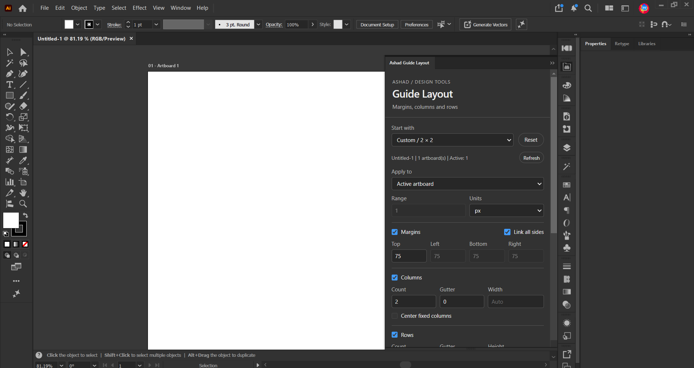
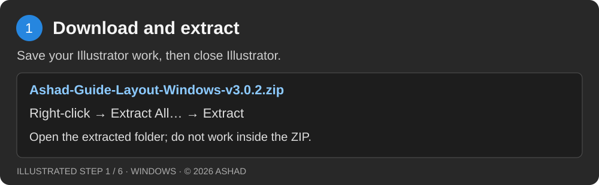
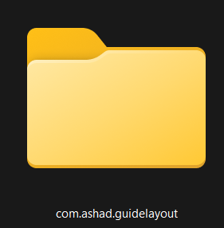
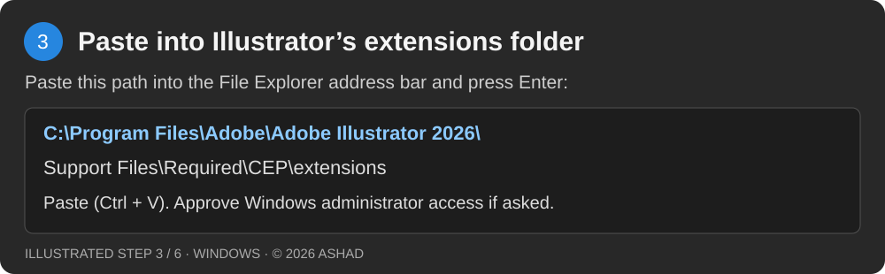
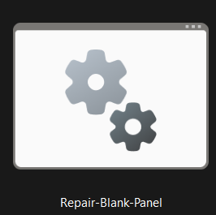
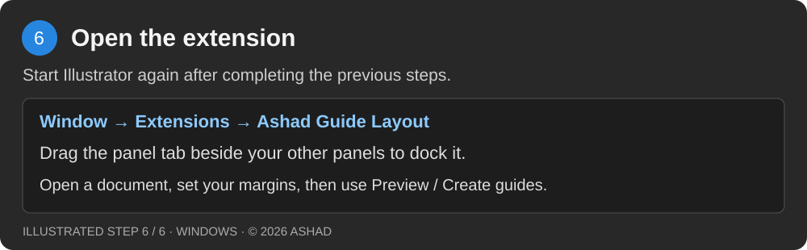
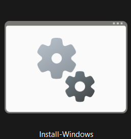

# Ashad Guide Layout

**Free margin and grid extension for Adobe Illustrator on Windows.**

Create margins, columns and rows, preview your layout, then create guides from a dockable Illustrator panel.

**Version 3.0.2 · Windows · Illustrator 2026 (30.0–30.9)**

## Download

**[Download the complete Windows ZIP](Ashad-Guide-Layout-Windows-v3.0.2.zip?raw=true)**

Illustrator must already be installed. This package does not include a Mac installer.



## Install by copying the folder

**Follow steps 1–5 below.** If you already installed the panel with **Install-Windows.cmd**, skip the folder-copy steps. Use one installation method only.

### 1. Close Illustrator and extract the ZIP

Save your work and close Illustrator. Right-click the downloaded ZIP → **Extract All** → **Extract**. Open the extracted package folder.



### 2. Copy com.ashad.guidelayout

Select the **com.ashad.guidelayout** folder shown below. Press **Ctrl + C** to copy it with all its contents.



This is a **folder**, not a single file. Copy this folder—not the entire extracted package and not only a `.jsx` file.

### 3. Paste into Illustrator's CEP extensions folder

In File Explorer, paste this exact path into the address bar and press **Enter**:

```text
C:\Program Files\Adobe\Adobe Illustrator 2026\Support Files\Required\CEP\extensions
```

Press **Ctrl + V** to paste **com.ashad.guidelayout** here. Windows may request administrator permission to write into Program Files. If you have permission, approve the copy.



The result should be:

```text
extensions
└── com.ashad.guidelayout
    ├── CSXS
    │   └── manifest.xml
    ├── index.html
    └── other extension files
```

Do not put a second **com.ashad.guidelayout** folder inside the first. If an older copy exists, back it up outside the extensions folder before replacing it. This path assumes Illustrator is installed in the default location shown above.

### 4. Run Repair-Blank-Panel

Return to the **extracted ZIP folder**. Keep Illustrator closed, then double-click **Repair-Blank-Panel.cmd**, shown below. Run it as the Windows user who will use Illustrator.



Windows may show the name as **Repair-Blank-Panel** when file extensions are hidden. Keep **Repair-Blank-Panel.ps1** beside the `.cmd` file; do not run the repair from inside the ZIP.

Wait for this success message:

```text
REPAIR SETTING VERIFIED.
```

**What this does:** The panel is unsigned. The repair checks the installed files and enables unsigned CEP 12 panels for your Windows account, including other unsigned panels. It backs up the previous setting before changing it. It does not copy missing files or reinstall the extension.

If you see **“Ashad Guide Layout was not found”**, repeat steps 2–3 and check that `CSXS\manifest.xml` is inside the copied folder. If a file is missing, extract the complete ZIP again and copy the complete extension folder before rerunning the repair.

### 5. Open the extension

Start Illustrator and choose **Window → Extensions → Ashad Guide Layout**. Drag the panel tab beside your other panels to dock it.



Open an Illustrator document to use the layout controls.

## Alternative: use the Windows installer

Use this as an alternative to the folder-copy steps above. If the panel already works, you do not need to install it again.



**This picture shows Install-Windows.cmd.** Windows hides the `.cmd` ending when file extensions are turned off. Double-click this file for automatic installation. **Repair-Blank-Panel.cmd** is a different file: use it after manual copying, or to repair the unsigned-panel setting.

1. Save your work and close Illustrator.
2. Extract the complete ZIP and open the extracted folder.
3. Double-click **Install-Windows.cmd**. Windows may display it as **Install-Windows**. Keep **Install-Windows.ps1** and **com.ashad.guidelayout** beside it.
4. Read the message, type **YES**, and press **Enter**. This installs the panel and enables unsigned CEP 12 panels for your Windows account.
5. Wait for **Installed**, then reopen Illustrator → **Window → Extensions → Ashad Guide Layout**.

The installer copies the panel to `%APPDATA%\Adobe\CEP\extensions\com.ashad.guidelayout`. It normally needs no administrator access. You do not also need to copy the folder into Program Files or run the repair after a successful installation.

[View all installer steps as a picture](install-windows-guide.svg)

## Create your first layout

1. Open a document with an artboard.
2. Choose a preset, target artboard(s) and units.
3. Set the margins. Check **Link all sides** for equal margins.
4. Enable columns or rows if needed. Set their count and gutter; leave Width or Height blank for automatic sizing.
5. Check **Preview**, then click **Create guides** when ready.

Turn **Preview** off before saving or closing the document. Choose **Editable lines** for coloured lines that appear in exports; native guides follow Illustrator's guide-colour preference.

## Need help?

| Problem | What to do |
| --- | --- |
| The panel opens but is blank | Close Illustrator, run **Repair-Blank-Panel.cmd**, wait for **REPAIR SETTING VERIFIED**, then reopen Illustrator. See step 4 above. |
| No extension in the menu | Confirm Illustrator is **2026 / 30.0–30.9**, check the folder structure in step 3, and restart Illustrator after installation. |
| Repair says the panel was not found | Copy the complete **com.ashad.guidelayout** folder to the exact location in step 3, then run the repair again. |
| Repair or installation reports missing files | Extract the entire ZIP again. Keep each `.cmd` file beside its matching `.ps1` file. |
| Guides are invisible | Choose **View → Guides → Show Guides** and check the guide layer's visibility. |
| The layout does not fit | Reduce margins, gutters or the number of columns/rows. |

If your work computer blocks installation, contact your administrator. If a problem remains, send Ashad your Illustrator version and the exact error message. Repairing the unsigned-panel setting will not fix every possible cause of a blank panel.

## Update or uninstall

**Folder-copy installation:** Close Illustrator. To update, back up the existing **com.ashad.guidelayout** folder outside the extensions folder, then replace it with the new complete folder. To uninstall, remove only **com.ashad.guidelayout** from the location in step 3. Removing the folder does not restore the unsigned-panel setting. Illustrator updates may remove manually copied extensions.

**Installer installation:** Close Illustrator and run the new package's **Install-Windows.cmd** to update. To uninstall, run **Uninstall-Windows.cmd**, type **YES**, then press **Enter** to keep the unsigned-panel setting or type **RESTORE** to restore the recorded previous setting. Restoration may affect other unsigned panels. The uninstaller does not remove manual Program Files copies.

Avoid keeping copies in both locations: Illustrator may load a different copy from the one you updated.

## Share and contact

Share this GitHub page or the complete **Ashad-Guide-Layout-Windows-v3.0.2.zip**. Keep the copyright notice with the package.

[WhatsApp](https://wa.me/918590956012) · [Instagram](https://www.instagram.com/as.hxd/) · [Behance](https://www.behance.net/muhammedashad) · [LinkedIn](https://www.linkedin.com/in/muhammed-ashad-79a329388) · [Pinterest](https://in.pinterest.com/muhammedashad2005/)

Email: muhammedashad2005@gmail.com · Phone: +91 8590956012

[Testing scope](TEST-REPORT.md) · [Download checksum](SHA256SUMS.txt) · [Use and sharing permission](COPYRIGHT.txt)

Native host checks were run in Illustrator 30.6.0. A fresh installation on another computer has not been verified.

© 2026 Ashad. See the included copyright notice for permission to install, use and share complete unmodified copies. This is an independent extension; Adobe and Illustrator belong to their respective owners.

