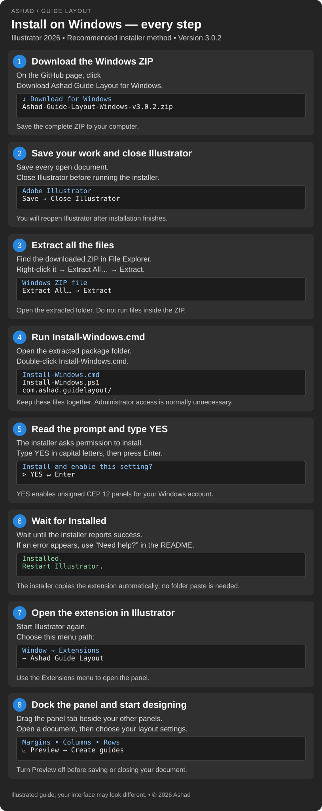
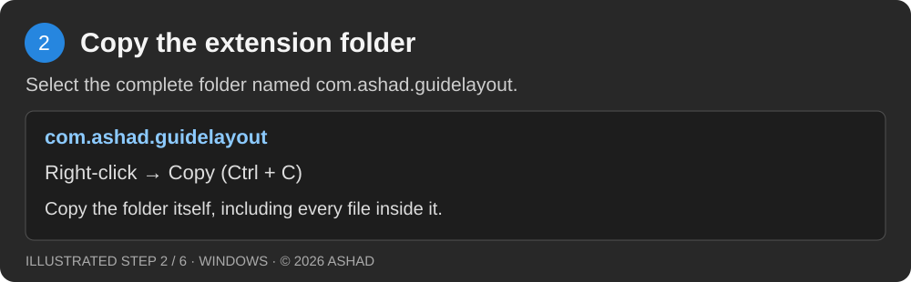
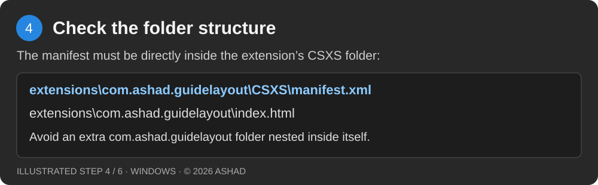
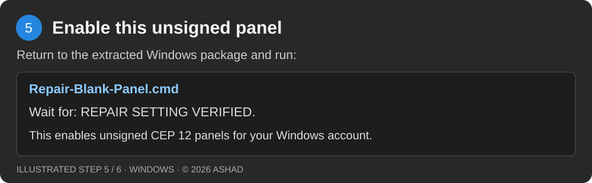

# Ashad Guide Layout

**Margins, columns and rows for Adobe Illustrator — by Ashad.**

Version **3.0.2** · Windows · Illustrator 2026

[Download for Windows](Ashad-Guide-Layout-Windows-v3.0.2.zip?raw=true) · [SHA-256 checksum](SHA256SUMS.txt)

A dockable extension for creating consistent artboard layouts. Set independent or linked margins, divide artboards into columns and rows, and preview the result before creating guides.

## Extension preview


*The extension running in Illustrator. Click the image to view it at full size.*

## Features

- Margins with linked or independent top, left, bottom and right values.
- Columns and rows with counts, gutters, automatic sizes or fixed sizes.
- Center fixed-width columns and fixed-height rows.
- Active artboard, all artboards or a range such as `1, 3-5`.
- Measurements in px, pt, mm, cm and inches.
- Six presets, including margins only, three-column print and twelve-column web layouts.
- Preview checkbox and native guides or editable coloured lines.
- Replace earlier Ashad guides on the chosen artboards.
- Illustrator theme colours and six compact social icons.

## Requirements

- Windows with Windows PowerShell available; the native host checks were run on Windows with Illustrator **30.6.0**.
- Adobe Illustrator 2026. The extension manifest accepts **30.0–30.9** with **CEP 12**. Other versions have not been validated.
- Permission to install a per-user extension and enable unsigned CEP 12 extensions. On a managed work computer, your administrator may restrict this.

This package does not include Illustrator. It contains a Windows installer, not a macOS installer or an Adobe-signed ZXP. No Node.js, separate extension manager or plugin account is needed to use it.

## Install — step by step



*Illustrated guide; Windows and Illustrator may look slightly different on your computer.*

1. Download the complete **Ashad-Guide-Layout-Windows-v3.0.2.zip** supplied by Ashad.
2. Save your Illustrator documents, then close Illustrator normally.
3. Right-click the ZIP in File Explorer and choose **Extract All**.
4. Open the extracted folder. You should see **Install-Windows.cmd**, **Install-Windows.ps1** and the **com.ashad.guidelayout** folder together. Do not run the installer inside the ZIP viewer.
5. Double-click **Install-Windows.cmd** as your normal Windows user. Administrator access is normally unnecessary.
6. Read the installer message. Type **YES**, then press **Enter**, to install and enable unsigned CEP 12 extensions.
7. Wait for **Installed**. If an error appears, keep its text and use the troubleshooting section below.
8. Start Illustrator. Open **Window → Extensions → Ashad Guide Layout**.
9. Drag the panel tab next to your other panels to dock it.

The installer copies only this extension to:

```text
%APPDATA%\Adobe\CEP\extensions\com.ashad.guidelayout
```

Do not copy the package into Illustrator's Plug-ins or Scripts folder. The `.jsx` file inside this package is the panel's internal engine; you do not need to run it manually.

## Manual installation — copy the extension folder

Use **one installation method**: the Windows installer above, or the manual copy method below. **com.ashad.guidelayout is a folder**, not a single file. These pictures illustrate the steps; the extension screenshot at the end shows the real panel.

### 1. Download, close Illustrator and extract

Download **Ashad-Guide-Layout-Windows-v3.0.2.zip**. Save your documents and close Illustrator. Right-click the ZIP → **Extract All** → **Extract**, then open the extracted folder.


### 2. Copy com.ashad.guidelayout

Inside the extracted package, select the complete **com.ashad.guidelayout** folder. Right-click → **Copy**, or press **Ctrl + C**. Keep all its contents together.



### 3. Paste into the Illustrator CEP extensions folder

In File Explorer, paste this full path into the address bar and press **Enter**:

```text
C:\Program Files\Adobe\Adobe Illustrator 2026\Support Files\Required\CEP\extensions
```

Press **Ctrl + V** to paste **com.ashad.guidelayout** here. Windows may ask for administrator permission; choose **Continue** if you have permission to install on this computer. If an older copy already exists, back it up outside the extensions folder before replacing it. If Illustrator is installed elsewhere, use its corresponding **Support Files\Required\CEP\extensions** folder.


### 4. Check the folder structure

The final manifest location must be:

```text
C:\Program Files\Adobe\Adobe Illustrator 2026\Support Files\Required\CEP\extensions\com.ashad.guidelayout\CSXS\manifest.xml
```

The **index.html** file must be directly inside **com.ashad.guidelayout**. Do not paste the entire ZIP package folder here, or nest a second **com.ashad.guidelayout** folder inside the first.



### 5. Enable the unsigned panel

Return to the extracted package and double-click **Repair-Blank-Panel.cmd**. Keep **Repair-Blank-Panel.ps1** beside it. Wait for **REPAIR SETTING VERIFIED**. This repair checks the installed files and enables unsigned CEP 12 panels for your Windows account; it does not copy or reinstall the extension. See the unsigned-extension explanation below.



### 6. Restart Illustrator and open the panel

Start Illustrator, then choose **Window → Extensions → Ashad Guide Layout**. Drag its tab beside your other panels to dock it. Open a document to use the layout controls.


**What the extension looks like in Illustrator:**


If you already installed a per-user copy with **Install-Windows.cmd**, updating that copy with the installer is simpler than keeping two installations. A higher-version per-user copy can take precedence over the application-folder copy. Illustrator updates or reinstalls may remove files placed inside its application folder. To uninstall a manual copy, close Illustrator and remove only its **com.ashad.guidelayout** folder; the packaged uninstaller handles only installations made by the installer.

### About the unsigned-extension setting

This locally distributed panel is unsigned. The installer sets the current user's `HKCU\Software\Adobe\CSXS.12\PlayerDebugMode` to the **String** value `1`. This permits unsigned CEP 12 panels, not only this panel. The previous value is recorded for optional restoration during uninstall. Adobe documents this setting in its [CEP 12 guide](https://github.com/Adobe-CEP/CEP-Resources/blob/master/CEP_12.x/Documentation/CEP%2012%20HTML%20Extension%20Cookbook.md#debugging-unsigned-extensions).

## First layout

1. Open or create an Illustrator document with an artboard.
2. In Ashad Guide Layout, choose **Margins only** or another preset.
3. Choose the target artboard(s) and units.
4. Enable margins and enter a value, for example **24 px**. Keep **Link all sides** checked for equal margins.
5. Enable columns or rows if needed. Leave Width or Height blank for automatic sizing.
6. Check **Preview** to inspect the layout. Uncheck it to remove the temporary preview.
7. Click **Create guides** to create the final layout on a separate layer.

Native guides follow Illustrator's guide-colour preference. If they are invisible, check **View → Guides → Show Guides**. Choose **Editable lines** when you need coloured lines that appear in exports; the HEX field applies to these lines.

Margins and gutters must fit within each selected artboard. If the panel reports a size error, reduce them or reduce the number of columns/rows.

## Preview and replacement

Turn Preview off before saving or closing a document. Preview changes can mark the document as modified. Switching documents turns preview off when detected; Refresh updates the document label.

Reopening the panel attempts to clean up its tagged preview leftovers after an interruption. Locked previews or groups containing added artwork are protected. The replacement option affects earlier guides owned by this extension on the target artboards; it does not delete all Illustrator guides.

## Update an existing installation

Save and close Illustrator, extract the newer ZIP, and run its **Install-Windows.cmd**. The installer backs up an existing per-user copy under `%LOCALAPPDATA%\Ashad\Guide Layout\Extension backups` before updating it. Reopen Illustrator afterward.

If you previously copied version 3.0.0 or 3.0.1 into Illustrator's application folder, this higher-version per-user copy takes precedence. The installer does not remove that older application-folder copy.

## Troubleshooting

| Problem | What to do |
| --- | --- |
| Panel appears in the menu but is blank | Save and close Illustrator. Run **Repair-Blank-Panel.cmd** from the extracted package. Wait for **REPAIR SETTING VERIFIED**, then reopen Illustrator. It verifies the unsigned-extension setting; it does not reinstall the panel. |
| No Ashad Guide Layout menu item | Confirm Illustrator is 2026 / 30.x, that installation completed without errors, and that you restarted Illustrator. Use **Window → Extensions**. |
| Installer asks you to close Illustrator | Save your work, close Illustrator normally, and run the installer again. |
| Missing files or missing PowerShell script | Extract the entire ZIP again. Keep the installer files and extension folder together. |
| Access denied or scripts restricted | Use your normal Windows account and a writable extracted folder. If organisational policy blocks installation, contact your administrator. |
| Guides are invisible | Turn on **View → Guides → Show Guides** and check the guide layer's visibility. |
| Preview looks wrong after changing documents | Turn Preview off, click **Refresh**, check the target and units, then preview again. |
| A social link does not open | Check your default browser. Links only open when clicked; the panel makes no automatic social requests. |

If the panel remains blank, include your Illustrator version and the relevant error text when contacting Ashad. CEP logs are normally in `%LOCALAPPDATA%\Temp`, with filenames beginning `CEP12-ILST` or `CEPHtmlEngine12-ILST`.

## Uninstall

1. Save your work and close Illustrator.
2. Run **Uninstall-Windows.cmd** from the extracted package.
3. Type **YES** to remove this per-user extension.
4. At the second prompt, press Enter to keep developer mode for other panels, or type **RESTORE** to restore the recorded previous setting.

The uninstaller requires this installer's receipt. It does not remove manual copies from Illustrator's application folder. If an older manual copy exists, it may appear again after the newer per-user copy is removed.

## Sharing with friends

Send the complete **Ashad-Guide-Layout-Windows-v3.0.2.zip** as a file attachment, or share the repository's download link. Friends should extract it and follow the installation steps above. Do not send only `host.jsx` or only the extension folder; the complete ZIP includes the installer and repair instructions.

Keep Ashad's copyright notice and contact information with the package. The included software does not grant any licence to Adobe Illustrator itself.

## Testing status

The layout engine and panel bridge have automated checks. Fifteen host checks previously passed inside Illustrator 30.6.0, and the six social destinations were checked using a simulated CEP bridge. The user's screenshot confirmed the earlier docked panel rendered. Version 3.0.2's compact icon appearance and a fresh installation on another computer have not been verified. See **TEST-REPORT.md** for the detailed scope.

## Contact Ashad

[WhatsApp](https://wa.me/918590956012) · [Pinterest](https://in.pinterest.com/muhammedashad2005/) · [Instagram](https://www.instagram.com/as.hxd/) · [LinkedIn](https://www.linkedin.com/in/muhammed-ashad-79a329388) · [GitHub](https://github.com/muhammedashad) · [Behance](https://www.behance.net/muhammedashad)

Email: muhammedashad2005@gmail.com · Phone: +91 8590956012

Copyright © 2026 Ashad. All rights reserved except the permission to install, use and share complete unmodified copies stated in **COPYRIGHT.txt**. Adobe, Illustrator and the social-platform names and marks belong to their respective owners. This is an independent extension.


